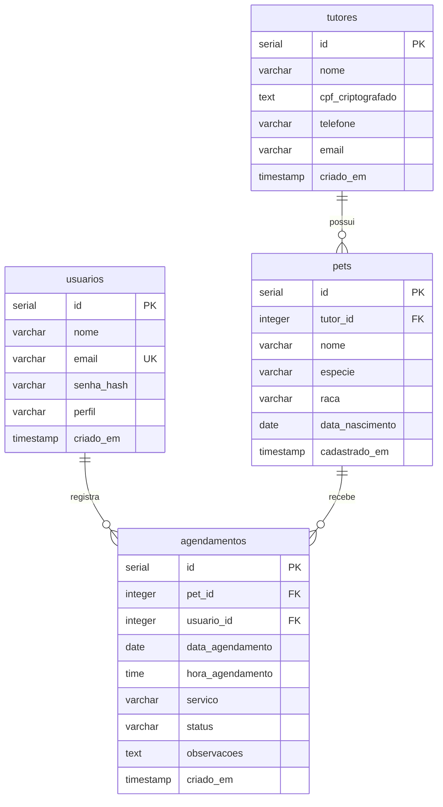

# SupVet

Sistema de gestão para clínicas veterinárias, feito em PHP com PostgreSQL. Permite gerenciar tutores, pets e agendamentos com acesso por e-mail e senha.

## Como rodar

Você precisa de PHP 8.2 ou superior com `pdo_pgsql`, `openssl`, `mbstring` e suporte a Argon2id, PostgreSQL com o cliente `psql` e Composer.

1. Inicie o PostgreSQL e execute na pasta principal:

   ```powershell
   psql -h 127.0.0.1 -U postgres -d postgres -v ON_ERROR_STOP=1 -f saep_db.sql
   ```

   Informe a senha do PostgreSQL. O script cria e seleciona `supvet_db`, cria as tabelas e inclui três registros por tabela. Execute pelo **psql**, pois `\connect` e `\gexec` não funcionam diretamente no Query Tool do pgAdmin. O script pode ser executado novamente sem apagar os registros existentes.

2. Confira `sistema/config/database.ini`: banco `supvet_db`, host `127.0.0.1`, porta `5432`, usuário e senha da sua instalação. A configuração local usa `postgres` / `postgres`. A chave `app_key` corresponde aos CPFs cifrados da carga inicial; alterá-la torna esses CPFs ilegíveis.
3. Se não existir `sistema/vendor/autoload.php`, execute `composer install` dentro de `sistema`.
4. Na pasta principal, execute:

   ```powershell
   php -S 127.0.0.1:8000 -t sistema/public sistema/public/index.php
   ```

Abra <http://127.0.0.1:8000>. Para parar, use `Ctrl+C` no terminal do servidor.

Usuários de demonstração, todos com senha `123456`:

| Nome | E-mail | Perfil |
| --- | --- | --- |
| Dra. Camila Alencar | camila.vet@supvet.com | veterinario |
| Lucas Fernandes | lucas.recepcao@supvet.com | recepcionista |
| Mariana Rocha | gestao@supvet.com | admin |

Os dados iniciais são fictícios. Todos os usuários acessam as mesmas funcionalidades.

## Requisitos e regras

| Requisito | Funcionamento |
| --- | --- |
| RF01 — Autenticação | Valida login e senha, informa falhas, mantém sessão com expiração e permite sair. A senha é armazenada com hash Argon2id. |
| RF02 — Painel principal | Exibe o nome do usuário e os acessos a tutores, pets e agendamentos. |
| RF03 — Tutores | Cadastra, lista, busca, edita e exclui tutores. O CPF é armazenado com criptografia AES-256-GCM. |
| RF04 — Pets | Cadastra e lista pets, sempre associados a um tutor existente. |
| RF05 — Agendamentos | Cadastra e lista por data e horário, mostra os dados do tutor e do pet e permite alterar data e hora. |

Regras de cadastro:

- Tutor exige nome, CPF válido, telefone com DDD e e-mail válido. Só pode ser excluído se não tiver pets vinculados.
- Pet exige tutor, nome, espécie, raça e nascimento válido, sem data futura.
- Agendamento exige pet, data, hora e serviço. O tutor vem do cadastro do pet, e o usuário responsável vem da sessão.
- A listagem segue data e hora crescentes. Os dados completos do tutor e do pet ficam nos detalhes de cada agendamento.

A sessão expira após 15 minutos sem uso. Esse tempo pode ser alterado em `session_timeout`, no arquivo `sistema/config/database.ini`.

O código usa MVC e autoload do Composer. As consultas usam PDO com parâmetros, e os formulários têm proteção CSRF. Os dados pessoais só aparecem após o login. O fuso horário é `America/Sao_Paulo`.

## Banco de dados e DER

O banco `supvet_db` tem quatro tabelas: `usuarios`, `tutores`, `pets` e `agendamentos`, com três registros iniciais em cada uma. O tutor do agendamento é obtido pelo pet; por isso, `agendamentos` não precisa repetir `tutor_id`.



Um tutor pode ter vários pets; cada pet pertence a um tutor e pode ter vários agendamentos. Cada agendamento tem um pet e um usuário responsável. Todas as chaves estrangeiras usam `ON DELETE RESTRICT`. O status aceita `AGENDADO`, `CONCLUIDO` e `CANCELADO`. As sequências dos IDs são ajustadas após a carga inicial.

## Organização e verificação

- `saep_db.sql`: criação e carga de `supvet_db`.
- `sistema/public/index.php`: entrada e rotas.
- `sistema/config/database.ini`: conexão, chave e expiração.
- `sistema/src/Controllers`: formulários e validação.
- `sistema/src/Models`: consultas e gravação.
- `sistema/src/Views`: telas PHP e HTML.
- `sistema/src/Core`: conexão, sessão, roteador, criptografia e validações.
- `sistema/tests/verificar.py`: verificação dos fluxos HTTP e do banco.

Com o banco importado e o servidor ligado, execute `py sistema/tests/verificar.py` na pasta principal (requer Python 3 e PHP). Os registros temporários do teste são removidos ao terminar. Para conferir expiração manualmente, reduza `session_timeout`, aguarde o prazo e acesse uma rota protegida; depois restaure `900`.
